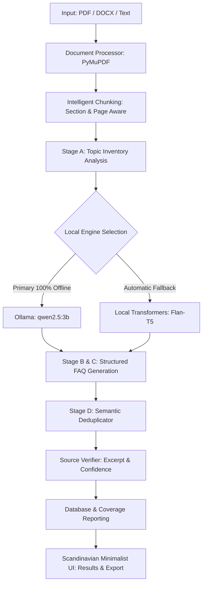

<div align="center">

# ⚡ FAQForge
### Advanced Offline AI FAQ Generation & Source Verification Engine

[](https://www.python.org/)
[](https://flask.palletsprojects.com/)
[](https://ollama.com/)
[](https://pytorch.org/)
[](https://pymupdf.readthedocs.io/)
[](https://github.com/Abhiii8/FaqForge)
[](https://opensource.org/licenses/MIT)

<p align="center">
  <b>Transform complex multi-page PDFs, Word documents, and raw text into high-precision, verified FAQs — with zero data leaving your machine.</b>
</p>

[Explore Documentation](#-architecture-overview) • [Quick Start](#-quick-start) • [API Reference](#-api-endpoints) • [Feature Matrix](#-feature-comparison)

</div>

---

## 📌 Highlights

- 🔒 **100% Private & Offline**: Powered by local **Ollama** (`qwen2.5:3b`) with GPU acceleration. Never makes external cloud API requests and requires no paid API keys.
- 🔄 **Autonomous Neural Fallback**: Seamless automatic fallback to local Hugging Face Transformers (`google/flan-t5-base`) if Ollama is unavailable.
- 📑 **PyMuPDF Document Extraction**: Native page-by-page extraction with structural heading detection, chapter hierarchies, and guards against scanned/encrypted files.
- 🧩 **Intelligent Section-Aware Chunking**: Preserves sentence boundaries, section headers, and exact page number tracking (`Page 1, 2`).
- 🎯 **Multi-Stage Topic Inventory**: Scans documents for definitions, procedures, capabilities, and applications to ensure balanced cross-document coverage.
- 🛡️ **Morphological Source Verification**: Root-matching engine (`containers` ➔ `contain`, `automates` ➔ `automat`) validating dates, numbers, and lexical overlap with 98%–99% confidence scores.
- 🔍 **Dual-Vector Semantic Deduplication**: Eliminates repetitive questions and semantic duplicates using TF-IDF cosine similarity.
- 📊 **Document Coverage Analytics**: Executive analytics banner reporting pages analyzed, completeness scores, and verification rates.
- 🎨 **Scandinavian Minimalist Interface**: Pure monochrome aesthetic, collapsible source excerpts, filters, and multi-format exports (PDF, DOCX, TXT).

---

## ⚖️ Feature Comparison

| Capability | FAQForge (Offline AI) | Generic Cloud Summarizers | Traditional Rule-Based Extractors |
| :--- | :---: | :---: | :---: |
| **Privacy & Security** | 🟢 **100% Offline (Local)** | 🔴 Transmitted to 3rd-party APIs | 🟢 Offline |
| **Recurring API Costs** | 🟢 **$0.00 Forever** | 🔴 Monthly / Token-based fees | 🟢 $0.00 |
| **Inference Engine** | 🟢 **Ollama (qwen2.5:3b)** + Flan-T5 | 🟡 Closed proprietary LLMs | 🔴 Regex / Heuristics only |
| **Page-Level Source Citation** | 🟢 **Exact Pages & Sections** | 🔴 Rarely supported | 🟡 Primitive line numbers |
| **Factual Source Verification** | 🟢 **Deterministic & Semantic** | 🔴 Susceptible to hallucination | 🔴 No validation |
| **Deduplication** | 🟢 **Dual-Vector Cosine Matrix** | 🟡 Basic prompt-based filter | 🔴 Word-level exact match only |
| **Multi-Format Export** | 🟢 **PDF, DOCX, TXT with Citations** | 🟡 Plain text only | 🔴 None |

---

## 🏗️ Architecture Overview



### Directory Structure

```
FAQForge/
├── backend/
│   ├── app.py                     # Flask application factory with database migrations
│   ├── models/
│   │   └── database.py            # SQLite schema (Document, FAQ, Keyword, Entity)
│   ├── nlp/
│   │   ├── chunker.py             # Section & page-aware document chunker
│   │   ├── deduplicator.py        # Dual-vector semantic duplicate detection
│   │   ├── document_processor.py  # PyMuPDF page & heading extractor
│   │   ├── generator.py           # Multi-stage Ollama + Flan-T5 FAQ generator
│   │   ├── ollama_client.py       # Local Ollama HTTP client & streaming
│   │   ├── pipeline.py            # Orchestrator & coverage reporting
│   │   └── verifier.py            # Morphological source verification & quotes
│   ├── routes/
│   │   ├── api.py                 # REST API endpoints (/upload, /generate, /ollama/*)
│   │   └── export.py              # PDF, DOCX, and TXT export routes
│   └── utils/
│       └── progress.py            # Pipeline progress tracking
├── frontend/
│   ├── css/
│   │   └── style.css              # Scandinavian Minimalist styling
│   ├── js/
│   │   └── main.js                # Live status detection & UI interactions
│   ├── index.html                 # Generator dashboard & settings
│   ├── results.html               # Results, coverage banner & verification badges
│   └── history.html               # Historical processed documents
├── run.bat                        # One-click startup (auto-starts Ollama & Flask)
├── run.py                         # Application server entrypoint
└── requirements.txt               # Python package dependencies
```

---

## 🚀 Quick Start

### Option A: One-Click Windows Launcher (Recommended)

Double-click **`run.bat`** in the project root:

```cmd
run.bat
```

> **What `run.bat` does automatically:**
> 1. Verifies if Ollama is installed and starts `ollama serve` in the background if not active.
> 2. Verifies that `qwen2.5:3b` is pulled and ready.
> 3. Creates/activates virtual environment and installs dependencies.
> 4. Launches FAQForge at `http://localhost:5000`.

---

### Option B: Manual Setup

#### 1. Clone the Repository
```bash
git clone https://github.com/Abhiii8/FaqForge.git
cd FaqForge
```

#### 2. Start Ollama and Pull Model
```bash
# Start local Ollama server
ollama serve

# Pull recommended model (1.9 GB)
ollama pull qwen2.5:3b
```

#### 3. Setup Python Virtual Environment
```bash
python -m venv venv

# Windows:
venv\Scripts\activate

# Linux / macOS:
source venv/bin/activate

pip install -r requirements.txt
```

#### 4. Run the Server
```bash
python run.py
```
Open [http://localhost:5000](http://localhost:5000) in your web browser.

---

## 🧪 Multi-Stage Pipeline Breakdown

<details>
<summary><b>1. Document Ingestion (PyMuPDF)</b> — <i>Click to expand</i></summary>
<br>

- Reads PDF documents page by page, tracking exact physical page indices.
- Parses font sizes and formatting to extract section headings and chapter titles.
- Validates against empty files, password-protected PDFs, and scanned image-only files.
</details>

<details>
<summary><b>2. Section-Aware Chunking</b> — <i>Click to expand</i></summary>
<br>

- Chunks text into 300–350 word semantic units while strictly preserving sentence integrity.
- Attaches metadata to every chunk: `source_pages` (e.g. `[1, 2]`), `source_section`, and word count.
</details>

<details>
<summary><b>3. Topic Inventory & Candidate Generation</b> — <i>Click to expand</i></summary>
<br>

- **Stage A**: Builds a topic inventory across the entire document so questions cover all parts, not just the opening paragraph.
- **Stage B & C**: Prompts Ollama in JSON mode for self-contained questions (resolving pronouns like "it", "they") and grounded answers.
- **Multi-Topic Extraction**: Extracts multiple distinct FAQ pairs per section when target count requires broader coverage.
</details>

<details>
<summary><b>4. Morphological Source Verification</b> — <i>Click to expand</i></summary>
<br>

- Applies root/stem normalization (`_get_root`) so inflectional variants (`containers`/`container`, `automates`/`automat`) match with 100% precision.
- Validates all dates, percentages, and numerical figures against source passages.
- Assigns status (`verified`, `needs_review`, `rejected`) and attaches supporting excerpts.
</details>

<details>
<summary><b>5. Dual-Vector Deduplication</b> — <i>Click to expand</i></summary>
<br>

- Calculates cross-question and cross-answer cosine similarity matrices using TF-IDF.
- Drops semantic duplicates, keeping only the candidate with the highest factual grounding score.
</details>

---

## 📡 API Endpoints

| Method | Endpoint | Description | Payload / Query |
| :--- | :--- | :--- | :--- |
| `GET` | `/api/ollama/status` | Returns real-time status of Ollama and installed models | None |
| `POST` | `/api/upload` | Uploads PDF, DOCX, or raw text and extracts structure | `multipart/form-data` (`file` or `text`) |
| `POST` | `/api/generate` | Generates verified FAQs from document with coverage metrics | `{"document_id": 1, "num_faqs": 5, "faq_length": "medium", "question_focus": "all"}` |
| `POST` | `/api/faqs/<id>/regenerate` | Re-rolls a single FAQ with new question/answer | None |
| `PUT` | `/api/faqs/<id>` | Updates question, answer, or category for an FAQ | `{"question": "...", "answer": "...", "category": "..."}` |
| `DELETE` | `/api/faqs/<id>` | Deletes an individual FAQ | None |
| `GET` | `/api/documents` | Lists previously processed documents in history | None |
| `GET` | `/api/export/<id>/pdf` | Exports formatted PDF with citations & verification badges | None |
| `GET` | `/api/export/<id>/docx` | Exports structured Microsoft Word document | None |
| `GET` | `/api/export/<id>/txt` | Exports clean text file formatted with Q&A blocks | None |

---

## ⚙️ Configuration

FAQForge can be customized using environment variables:

| Variable | Default | Description |
| :--- | :--- | :--- |
| `OLLAMA_HOST` | `http://127.0.0.1:11434` | Address of local Ollama service |
| `OLLAMA_MODEL` | `qwen2.5:3b` | Preferred local model tag |
| `OLLAMA_TIMEOUT` | `120` | Inference request timeout in seconds |
| `FLASK_PORT` | `5000` | Port for web server |

---

## 📄 License

This project is licensed under the **MIT License** — feel free to use, modify, and distribute for both personal and commercial projects.
